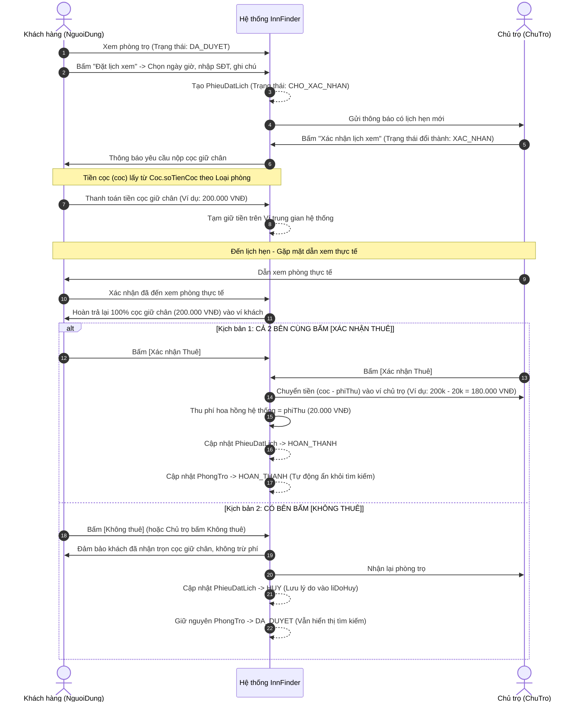

# INNFINDER - HỆ THỐNG QUY TẮC, ĐẶC TẢ NGHIỆP VỤ & CLASS DIAGRAM CHUẨN
### TÀI LIỆU DÀNH CHO TẤT CẢ AI AGENT & THÀNH VIÊN NHÓM PHÁT TRIỂN

> **QUY TẮC BẤT KHẢ XÂM PHẠM DÀNH CHO AI AGENT (ANTIGRAVITY / COPILOT / CURSOR):**
> 1. Mọi Agent khi vào dự án **BẮT BUỘC ĐỌC VÀ TUÂN THỦ** toàn bộ quy tắc, đặc tả class và ràng buộc regex trong file này.
> 2. **TUYỆT ĐỐI KHÔNG TỰ Ý SỬA CODE, TẠO MỚI HOẶC GHI ĐÈ FILE** khi chưa trình bày phương án và chưa được Tech Lead (User) duyệt bằng văn bản.
> 3. Áp dụng chuẩn **Sơ đồ Class Diagram mới**: Không tạo bảng `KhachHang`, không tạo mã riêng `maCT` cho `ChuTro`, không tạo bảng `Admin` riêng.

---

## MỤC LỤC
1. [Kiến trúc Kỹ thuật & Hạ tầng](#1-kiến-trúc-kỹ-thuật--hạ-tầng)
2. [Chi tiết Toàn bộ Luồng Nghiệp vụ Hệ thống (8 Use Cases Chính Thức)](#2-chi-tiết-toàn-bộ-luồng-nghiệp-vụ-hệ-thống-8-use-cases-chính-thức)
   - 2.1. Đăng ký & Kích hoạt tài khoản (UC: Đăng ký)
   - 2.2. Tìm kiếm & Xem chi tiết phòng trọ (UC: Tìm kiếm phòng trọ)
   - 2.3. Đặt lịch xem phòng, Cọc giữ chân, Hoàn cọc & Thu phí hoa hồng (Quy trình Swimlane cốt lõi)
   - 2.4. Đăng tin phòng trọ mới & Admin kiểm duyệt (UC: Thêm phòng trọ)
   - 2.5. Đánh giá chất lượng phòng sau khi xem (UC: Đánh giá phòng)
   - 2.6. Quản lý ví & Yêu cầu rút tiền về ngân hàng (UC: Tạo yêu cầu rút tiền)
   - 2.7. Gửi khiếu nại, Tố cáo & Xử lý vi phạm (UC: Gửi khiếu nại)
   - 2.8. Quản trị viên cập nhật & Quản lý người dùng (UC: Cập nhật tài khoản)
3. [Đặc tả Chi tiết 15 Class Thực thể (Theo Class Diagram Mới)](#3-đặc-tả-chi-tiết-15-class-thực-thể-theo-class-diagram-mới)
4. [Đặc tả Chi tiết 6 Enum Hệ thống](#4-đặc-tả-chi-tiết-6-enum-hệ-thống)
5. [Quy chuẩn Kỹ thuật Bắt buộc (Technical Architecture Standards)](#5-quy-chuẩn-kỹ-thuật-bắt-buộc-technical-architecture-standards)
6. [Quy trình Thao tác của Agent (Agent Workflow Protocol)](#6-quy-trình-thao-tác-của-agent-agent-workflow-protocol)

---

## 1. KIẾN TRÚC KỸ THUẬT & HẠ TẦNG

- **Database**: MariaDB 11.2 (Docker Compose, Port `3307`, Database: `innfinder_db`, phpMyAdmin: `8081`).
- **Backend Stack**: Spring Boot 3.4.x, Java 21, Spring Security Stateless, JJWT (0.12.6), Flyway Migration.
- **Phân lớp chuẩn**:
  - `com.innfinder.backend.entity`: Chứa 15 Entity và 6 Enum theo đúng Class Diagram mới.
  - `com.innfinder.backend.dto`: Chứa Request/Response DTO; bắt buộc dùng Bean Validation (`@Pattern`, `@NotBlank`, `@Min`, `@Max`, `@Email`).
  - `com.innfinder.backend.repository`: Spring Data JPA interface.
  - `com.innfinder.backend.service`: Nghiệp vụ trung tâm, quản lý Transaction `@Transactional`.
  - `com.innfinder.backend.controller`: REST Controller, luôn trả về cấu trúc `ApiResponse<T>`.
  - `com.innfinder.backend.exception`: Ngoại lệ chuẩn `AppException` & `ErrorCode`, xử lý tập trung bởi `GlobalExceptionHandler`.

---

## 2. CHI TIẾT TOÀN BỘ LUỒNG NGHIỆP VỤ HỆ THỐNG (8 USE CASES CHÍNH THỨC)

### 2.1. Đăng ký & Kích hoạt tài khoản (UC: Đăng ký)
- **Mục đích**: Cho phép Khách vãng lai tạo tài khoản mới trên hệ thống để tìm kiếm phòng hoặc đăng tin cho thuê.
- **Actor chính**: Khách vãng lai (Chưa đăng nhập).
- **Tiền điều kiện**: Email và số điện thoại chưa từng đăng ký trên hệ thống.
- **Luồng sự kiện chính**:
  1. Người dùng nhập thông tin: Tên đăng nhập, Mật khẩu, Xác nhận mật khẩu, Email, Số điện thoại, CCCD (nếu đăng ký làm chủ phòng).
  2. Lựa chọn vai trò ban đầu: Người tìm thuê (`chuTro = false`) hoặc Người cho thuê (`chuTro = true`).
  3. Nhấn nút "Tạo tài khoản".
  4. Hệ thống kiểm tra dữ liệu: Regex email, sđt, cccd, độ dài mật khẩu và kiểm tra mật khẩu trùng khớp.
  5. Hệ thống tạo tài khoản `NguoiDung` (mã tự sinh `^ND\d{8}\d{4}$`), nếu là người cho thuê thì đồng thời khởi tạo bản ghi `ChuTro` (số dư = 0, điểm uy tín = 100).
  6. Hệ thống gửi email chứa liên kết xác thực đến địa chỉ email đã đăng ký.
  7. Hiển thị thông báo đăng ký thành công, yêu cầu người dùng xác thực email để kích hoạt.
- **Luồng thay thế / Ngoại lệ**:
  - *Đăng ký qua Google OAuth2*: Người dùng chọn "Đăng ký với Google" ➔ Xác thực tài khoản Google ➔ Hệ thống tự động tạo `NguoiDung` tương ứng và cấp JWT đăng nhập.
  - *Lỗi mật khẩu không khớp*: Báo lỗi và yêu cầu nhập lại.
  - *Email/SĐT đã tồn tại*: Báo lỗi trùng lặp dữ liệu.

---

### 2.2. Tìm kiếm & Xem chi tiết phòng trọ (UC: Tìm kiếm phòng trọ)
- **Mục đích**: Giúp khách hàng tìm thấy phòng trọ phù hợp nhất theo nhu cầu vị trí, giá cả và tiện ích.
- **Actor chính**: Khách hàng / Khách vãng lai.
- **Tiền điều kiện**: Truy cập giao diện tìm kiếm phòng trọ.
- **Luồng sự kiện chính**:
  1. Khách hàng nhập tiêu chí tìm kiếm: Khu vực/địa chỉ, mức giá từ - đến, diện tích, số người ở, loại phòng (`LoaiPhongTro`), các tiện ích mong muốn (`TienIch`).
  2. Nhấn nút "Tìm kiếm".
  3. Hệ thống truy vấn các phòng có trạng thái `TrangThaiPhongTro = DA_DUYET`, hiển thị danh sách kết quả kết hợp đánh dấu (marker) trên bản đồ dựa trên `kinhDo`, `viDo`.
  4. Khách hàng chọn một phòng trọ để xem chi tiết.
  5. Hệ thống hiển thị trang thông tin chi tiết phòng: Ảnh thực tế (`HinhAnh`), giá thuê, tiền cọc hợp đồng (`cocPhong`), danh sách tiện ích (`TienIchPhong`), nội quy, vị trí trên bản đồ, điểm uy tín của Chủ trọ và các đánh giá (`DanhGia`) từ khách trước.
- **Luồng thay thế**:
  - Khách hàng có thể bấm nút "Yêu thích" để lưu phòng vào danh sách `PhongYeuThich`.

---

### 2.3. Đặt lịch xem phòng, Cọc giữ chân, Hoàn cọc & Thu phí hoa hồng (Quy trình Swimlane cốt lõi)
- **Mục đích**: Đảm bảo quyền lợi giữa Khách thuê và Chủ trọ, hạn chế tình trạng "bỏ bom" lịch hẹn thông qua cơ chế cọc giữ chân linh hoạt theo loại phòng.
- **Actor chính**: Khách hàng (`NguoiDung`), Chủ trọ (`ChuTro`), Hệ thống trung gian InnFinder.
- **Bản chất kinh tế**:
  - Mức cọc giữ chân xem phòng (`Coc.soTienCoc`) được quy định **động theo từng loại phòng** (`LoaiPhongTro`).
  - Phí dịch vụ hệ thống (`PhiThu.phi`) là khoản hoa hồng hệ thống trích lại từ tiền cọc khi giao dịch thuê phòng thành công.
  - **QUY TẮC BẤT KHẢ XÂM PHẠM VỀ DOANH THU SÀN (PLATFORM REVENUE RULE)**:
    - Sàn InnFinder vận hành theo cơ chế thu phí hoa hồng môi giới thành công. Doanh thu của hệ thống **BẮT BUỘC ĐƯỢC TÍNH TỪ TỔNG `phiThu` CỦA CÁC PHIẾU ĐẶT LỊCH ĐÃ HOÀN TẤT** (`PhieuDatLich.trangThai = HOAN_THANH`).
    - **NGHIÊM CẤM TÍNH DOANH THU TỪ BẢNG `GiaoDich`**: Bảng `GiaoDich` chỉ đóng vai trò là sổ cái ghi nhận biến động dòng tiền (tiền cọc tạm giữ, hoàn cọc cho khách, thanh toán cho chủ trọ, rút tiền). Việc tính tổng số tiền giao dịch làm sai lệch hoàn toàn bản chất tài chính của sàn.



---

### 2.4. Đăng tin phòng trọ mới & Admin kiểm duyệt (UC: Thêm phòng trọ)
- **Mục đích**: Cho phép Chủ trọ tạo bài đăng cho thuê và Admin kiểm duyệt chất lượng trước khi hiển thị công khai.
- **Actor chính**: Chủ trọ (`ChuTro`), Quản trị viên (`Admin` - `NguoiDung` có `vaiTro = QUAN_TRI`).
- **Tiền điều kiện**: Tài khoản đã đăng nhập và đã kích hoạt vai trò Chủ trọ (`chuTro = true`).
- **Luồng sự kiện chính**:
  1. Chủ trọ chọn chức năng "Thêm phòng trọ".
  2. Điền đầy đủ thông tin: Tiêu đề, địa chỉ, tọa độ bản đồ (`kinhDo`, `viDo`), giá thuê (`giaThue`), diện tích (`dienTich`), số người tối đa, loại phòng (`LoaiPhongTro`), tiền cọc hợp đồng (`cocPhong`), chọn danh sách tiện ích (`TienIchPhong`) và upload tối thiểu 1 hình ảnh đại diện (`HinhAnh`).
  3. Bấm "Gửi duyệt bài".
  4. Hệ thống kiểm tra hợp lệ và sinh mã phòng tự động theo định dạng `PTDDMMYYHHmmSS`.
  5. Hệ thống lưu phòng với trạng thái `TrangThaiPhongTro = CHO_DUYET`.
  6. Admin truy cập màn hình kiểm duyệt:
     - *Nếu duyệt*: Trạng thái chuyển thành `DA_DUYET` ➔ Phòng hiển thị công khai trên ứng dụng.
     - *Nếu từ chối*: Trạng thái chuyển thành `HUY` kèm lý do từ chối ➔ Gửi thông báo cho Chủ trọ.

---

### 2.5. Đánh giá chất lượng phòng sau khi xem (UC: Đánh giá phòng)
- **Mục đích**: Khách hàng chia sẻ trải nghiệm thực tế về phòng trọ và thái độ của chủ trọ.
- **Actor chính**: Khách hàng (`NguoiDung`).
- **Tiền điều kiện**: Khách hàng đã hoàn thành việc xem phòng (phiếu đặt lịch đã xác nhận xem phòng hoặc đạt trạng thái `HOAN_THANH`).
- **Luồng sự kiện chính**:
  1. Khách hàng truy cập vào phiếu hẹn trong lịch sử hoặc bấm thông báo "Đánh giá phòng đã xem".
  2. Chọn số sao đánh giá (từ 1 đến 5 sao theo trường `diem`).
  3. Viết nhận xét chi tiết vào trường `noiDung`.
  4. Đính kèm hình ảnh thực tế nếu có (dung lượng tối đa 10MB/ảnh).
  5. Bấm "Gửi đánh giá".
  6. Hệ thống lưu bản ghi vào `DanhGia`, cập nhật điểm trung bình của phòng và gửi thông báo cho Chủ trọ.

---

### 2.6. Quản lý ví & Yêu cầu rút tiền về ngân hàng (UC: Tạo yêu cầu rút tiền)
- **Mục đích**: Cho phép Người dùng / Chủ trọ rút số dư khả dụng từ ví hệ thống về tài khoản ngân hàng cá nhân.
- **Actor chính**: Người dùng (`NguoiDung`), Chủ trọ (`ChuTro`).
- **Tiền điều kiện**: Tài khoản có số dư khả dụng `soDu > 0` và đã liên kết tối thiểu 1 tài khoản ngân hàng (`TaiKhoanNganHang`).
- **Luồng sự kiện chính**:
  1. Người dùng chọn mục "Rút tiền" trên màn hình quản lý ví.
  2. Hệ thống hiển thị số dư khả dụng hiện tại và danh sách tài khoản ngân hàng đã liên kết.
  3. Người dùng nhập số tiền muốn rút và chọn ngân hàng nhận tiền.
  4. Hệ thống kiểm tra ràng buộc: Số tiền rút phải `> 0`, nhỏ hơn hoặc bằng `soDu`, nằm trong hạn mức cho phép.
  5. Hệ thống hiển thị modal xác thực yêu cầu nhập OTP hoặc mật khẩu cấp 2.
  6. Người dùng xác nhận OTP.
  7. Hệ thống tạo bản ghi `GiaoDich` với trạng thái `CHO_THANH_TOAN` (hoặc `CHO_DUYET`), tạm giữ số dư tương ứng.
  8. Hệ thống thông báo tạo yêu cầu rút tiền thành công và chuyển cho bộ phận tài chính/cổng thanh toán xử lý.

---

### 2.7. Gửi khiếu nại, Tố cáo & Xử lý vi phạm (UC: Gửi khiếu nại)
- **Mục đích**: Giải quyết các tranh chấp, báo cáo thông tin phòng sai sự thật hoặc hành vi lừa đảo.
- **Actor chính**: Người gửi khiếu nại (`NguoiDung`), Quản trị viên (`QUAN_TRI`), Đối tượng bị phản ánh (`NguoiDung`).
- **Luồng sự kiện chính**:
  1. Người dùng chọn chức năng "Tạo khiếu nại".
  2. Điền thông tin: Chọn đối tượng khiếu nại, phòng liên quan (nếu có), mô tả chi tiết vấn đề (`vanDe`) và tải lên ảnh bằng chứng vi phạm (`hinhAnh`).
  3. Bấm "Gửi khiếu nại".
  4. Hệ thống tạo phiếu `PhieuKhieuNai` với trạng thái `TrangThaiKhieuNai = CHO_DUYET`.
  5. Admin tiếp nhận, đổi trạng thái sang `DANG_XU_LY`, liên hệ xác minh hai bên.
  6. Admin đưa ra kết luận xử lý:
     - Chuyển trạng thái sang `DA_XU_LI`.
     - Phân định mức độ vi phạm (`MucDoViPham`):
       - `NHE`: Cảnh cáo nhắc nhở qua email/hệ thống.
       - `TRUNG_BINH`: Trừ điểm uy tín (`diemUyTin`) của chủ trọ, tạm ẩn bài đăng 7 ngày.
       - `NANG`: Khóa tài khoản vĩnh viễn, tịch thu cọc và hỗ trợ người bị hại.

---

### 2.8. Quản trị viên cập nhật & Quản lý người dùng (UC: Cập nhật tài khoản)
- **Mục đích**: Cho phép Admin quản lý thông tin thành viên, hỗ trợ điều chỉnh tài khoản hoặc xử lý các sự cố nghiệp vụ.
- **Actor chính**: Quản trị viên (`QUAN_TRI`).
- **Tiền điều kiện**: Đăng nhập tài khoản có quyền Quản trị.
- **Luồng sự kiện chính**:
  1. Admin vào trang "Quản lý Người dùng".
  2. Tìm kiếm và chọn tài khoản cần quản lý theo mã định danh `maNguoiDung` hoặc Email/SĐT.
  3. Xem chi tiết thông tin: Hồ sơ cá nhân, vai trò, số dư, danh sách phòng trọ, lịch sử giao dịch và lịch sử vi phạm.
  4. Thực hiện chỉnh sửa trạng thái (Khóa tài khoản, Mở khóa, Cập nhật trạng thái duyệt CCCD trở thành Chủ trọ).
  5. Hệ thống ghi nhận lịch sử thay đổi (Audit Log) và thông báo đến người dùng.

---

## 3. ĐẶC TẢ CHI TIẾT 15 CLASS THỰC THỂ (THEO CLASS DIAGRAM MỚI)

### 1. `NguoiDung` (Bảng trung tâm tài khoản hệ thống)
*Không còn bảng KhachHang và Admin riêng. Mọi đối tượng tài khoản (Khách hàng, Chủ trọ, Quản trị viên) đều xuất phát từ `NguoiDung`.*

| STT | Thuộc tính | Kiểu dữ liệu | Ràng buộc & Regex | Ghi chú |
|:---:|:---|:---|:---|:---|
| 1 | `maNguoiDung` | String | `^ND\d{8}\d{4}$` | Định dạng: `ND` + `ddMMyyyy` + `XXXX` (14 ký tự) |
| 2 | `tenDangNhap` | String | Không rỗng, 3 đến 50 ký tự | Tên đăng nhập duy nhất |
| 3 | `hoVaTen` | String | Tối đa 100 ký tự | Họ và tên đầy đủ của người dùng |
| 4 | `matKhau` | String | Không rỗng, tối thiểu 8 ký tự | Lưu BCrypt hash |
| 5 | `hinhDaiDien` | HinhAnh | Có thể rỗng | Ảnh đại diện |
| 6 | `email` | String | `^[A-Za-z0-9._%+-]+@[A-Za-z0-9.-]+\.[A-Za-z]{2,}$` | Email chuẩn RFC 5322 |
| 7 | `sdt` | String | `^(03\|05\|07\|08\|09)\d{8}$` hoặc `^\+84\d{9}$` | Số điện thoại Việt Nam |
| 8 | `vaiTro` | VaiTro (Enum) | `QUAN_TRI`, `KHACH_HANG` | Phân quyền hệ thống |
| 9 | `cccd` | String | `^\d{12}$` | CCCD gồm đúng 12 chữ số |
| 10| `thoiGianMoTaiKhoan`| LocalDate | Không được rỗng, `>= LocalDate.now()` | Ngày tạo tài khoản |
| 11| `dsTaiKhoanNganHang`| List\<TaiKhoanNganHang\> | Quan hệ 1 - Nhiều (1..*) | Danh sách tài khoản ngân hàng liên kết |
| 12| `dsKhieuNai` | List\<PhieuKhieuNai\> | Có thể rỗng | Khiếu nại liên quan |
| 13| `dsViPham` | List\<ViPham\> | Có thể rỗng | Lịch sử vi phạm |
| 14| `dsDanhGia` | List\<DanhGia\> | Có thể rỗng | Đánh giá đã thực hiện |
| 15| `dsGD` | List\<GiaoDich\> | Có thể rỗng | Lịch sử giao dịch |
| 16| `chuTro` | Boolean | True / False | Cờ xác định tài khoản đã kích hoạt vai trò Chủ trọ |

- **Phương thức bắt buộc**:
  - `+ NguoiDung(...)`
  - `+ isChuTro(): Boolean`
  - `+ toString(): String`

---

### 2. `ChuTro` (Mở rộng cho Người dùng là Chủ sở hữu phòng)
*Không còn mã `maCT` riêng. Định danh chủ trọ chính là `NguoiDung` thông qua liên kết (1) --- (0..1).*

| STT | Thuộc tính | Kiểu dữ liệu | Ràng buộc & Regex | Ghi chú |
|:---:|:---|:---|:---|:---|
| 1 | `diemUyTin` | int | `>= 0`, mặc định khởi tạo là `100` | Điểm uy tín của chủ trọ |
| 2 | `soDu` | long | `>= 0` | Số dư tài khoản ví chủ trọ |
| 3 | `dsPhongTro` | List\<PhongTro\> | Quan hệ 1 - Nhiều | Danh sách phòng trọ đang quản lý |

- **Phương thức bắt buộc**:
  - `+ chuTro(maVi, matKhauVi, soDu)`
  - `+ toString(): String`

---

### 3. `TaiKhoanNganHang`
| STT | Thuộc tính | Kiểu dữ liệu | Ràng buộc & Regex | Ghi chú |
|:---:|:---|:---|:---|:---|
| 1 | `soTaiKhoan` | String | `^\d{6,20}$` | Dãy từ 6 đến 20 chữ số |
| 2 | `tenNganHang` | String | Không rỗng, chỉ chứa chữ cái và khoảng trắng | Tên ngân hàng (ví dụ: `Vietcombank`) |

- **Quan hệ**: `NguoiDung` (1) --- (1..*) `TaiKhoanNganHang`
- **Phương thức**: `+ taiKhoanNganHang(soTaiKhoan, tenNganHang)`, `+ toString(): String`

---

### 4. `PhongTro`
| STT | Thuộc tính | Kiểu dữ liệu | Ràng buộc & Regex | Ghi chú |
|:---:|:---|:---|:---|:---|
| 1 | `maPhongTro` | String | Đúng 14 ký tự định dạng `PTDDMMYYHHmmSS` | Tiền tố `PT` + Ngày-Tháng-Năm-Giờ-Phút-Giây |
| 2 | `chuPhongTro` | ChuTro | Không được rỗng | Chủ sở hữu phòng trọ |
| 3 | `giaThue` | long | `>= 0` | Giá thuê mỗi tháng |
| 4 | `dienTich` | int | `>= 0` | Diện tích ($m^2$) |
| 5 | `hinhAnh` | List\<HinhAnh\> | Tối thiểu 1 ảnh đại diện | Danh sách ảnh chụp phòng |
| 6 | `moTa` | String | Cho phép rỗng | Mô tả chi tiết phòng trọ |
| 7 | `soNguoi` | int | `>= 0` | Số lượng người ở tối đa |
| 8 | `loaiPhong` | LoaiPhongTro | Không được rỗng | Loại hình phòng trọ |
| 9 | `thoiGianDang`| LocalDateTime | Không được rỗng | Thời điểm đăng tin |
| 10| `trangThai` | TrangThaiPhongTro | `HUY`, `CHO_DUYET`, `DA_DUYET`, `HOAN_THANH` | Trạng thái tin phòng |
| 11| `dsDanhGia` | List\<DanhGia\> | Có thể rỗng | Danh sách đánh giá phòng |
| 12| `kinhDo` | String | Tọa độ kinh độ (Longitude) hợp lệ | Tọa độ bản đồ |
| 13| `viDo` | String | Tọa độ vĩ độ (Latitude) hợp lệ | Tọa độ bản đồ |
| 14| `diaChi` | String | Không được rỗng | Địa chỉ cụ thể |
| 15| `cocPhong` | long | `>= 0` | Tiền cọc hợp đồng thuê phòng |

- **Phương thức**:
  - `+ phongTro(maPhongTro, chuPhongTro, giaThue, dienTich, hinhAnh, moTa, soNguoi, loaiPhong, thoiGianDang, trangThai, dsDanhGia, kinhDo, viDo, diaChi, coc)`
  - `+ toString(): String`

---

### 5. `LoaiPhongTro`
| STT | Thuộc tính | Kiểu dữ liệu | Ràng buộc & Regex | Ghi chú |
|:---:|:---|:---|:---|:---|
| 1 | `maLPT` | String | `^LPT\d{3}$` (Đúng 6 ký tự: `LPT` + 3 số) | Mã loại phòng (ví dụ: `LPT001`) |
| 2 | `tenLoaiPhongTro`| String | Không được rỗng | Tên loại phòng (Ví dụ: Ký túc xá, Căn hộ mini) |
| 3 | `moTa` | String | Cho phép rỗng | Mô tả đặc điểm loại phòng |

- **Quan hệ**: 
  - `LoaiPhongTro` (1) --- (0..n) `PhongTro`
  - `LoaiPhongTro` (1) --- (1) `Coc` (Mỗi loại phòng có đúng 1 mức cọc xem tương ứng)
- **Phương thức**: `+ loaiPhongTro(maLPT, tenLoaiPhongTro, moTa)`, `+ toString(): String`

---

### 6. `Coc` (Mức cọc xem phòng)
| STT | Thuộc tính | Kiểu dữ liệu | Ràng buộc & Regex | Ghi chú |
|:---:|:---|:---|:---|:---|
| 1 | `maCoc` | String | Không được rỗng, định dạng `^COC\d{3,}$` | Mã định danh mức cọc |
| 2 | `soTienCoc` | int | `> 0` | Cước cọc xem phòng quy định theo loại phòng |
| 3 | `loaiPhong` | LoaiPhongTro | Quan hệ 1 - 1 | Loại phòng áp dụng |

- **Quan hệ**: `Coc` (1) --- (1) `LoaiPhongTro`, `Coc` (1) --- (1) `PhiThu`

---

### 7. `PhiThu` (Phí dịch vụ trích lại cho hệ thống)
| STT | Thuộc tính | Kiểu dữ liệu | Ràng buộc & Regex | Ghi chú |
|:---:|:---|:---|:---|:---|
| 1 | `maPhiThu` | String | Không được rỗng, định dạng `^PT\d{3,}$` | Mã định danh mức phí |
| 2 | `coc` | Coc | Quan hệ 1 - 1 với Coc | Mức cọc tương ứng |
| 3 | `phi` | int | `>= 0` và `< soTienCoc` | Phí hoa hồng hệ thống trích lại khi thuê phòng thành công |

- **Quan hệ**: `PhiThu` (1) --- (1) `Coc`

---

### 8. `PhieuDatLich`
| STT | Thuộc tính | Kiểu dữ liệu | Ràng buộc & Regex | Ghi chú |
|:---:|:---|:---|:---|:---|
| 1 | `maDatLich` | String | Không được rỗng | Mã phiếu đặt lịch |
| 2 | `khachHang` | NguoiDung | Không được rỗng | Khách hàng đặt lịch hẹn xem (NguoiDung) |
| 3 | `phongTro` | PhongTro | Không được rỗng | Phòng trọ được hẹn xem |
| 4 | `ngayHen` | LocalDateTime | `>= LocalDateTime.now()` | Thời gian hẹn gặp |
| 5 | `trangThai` | TrangThaiDatLich | `CHO_XAC_NHAN`, `HUY`, `XAC_NHAN`, `HOAN_THANH` | Trạng thái lịch |
| 6 | `coc` | long | `> 0` | Lấy từ `Coc.soTienCoc` theo `LoaiPhongTro` |
| 7 | `phiThu` | long | `>= 0` | Lấy từ `PhiThu.phi` tương ứng |
| 8 | `liDoHuy` | String | Cho phép rỗng, bắt buộc khi hủy lịch | Lý do hủy lịch |

- **Phương thức**:
  - `+ phieuDatLich(maDatLich, khachHang, phongTro, ngayHen, trangThai, liDoHuy, coc, phiThu)`
  - `+ toString(): String`

---

### 9. `HinhAnh`
| STT | Thuộc tính | Kiểu dữ liệu | Ràng buộc & Regex | Ghi chú |
|:---:|:---|:---|:---|:---|
| 1 | `maHinhAnh` | String | Không được rỗng | Mã hình ảnh |
| 2 | `phongTro` | PhongTro | Không được rỗng | Phòng trọ sở hữu ảnh |
| 3 | `url` | String | URL CDN/Cloudinary hợp lệ | Đường dẫn ảnh |
| 4 | `thuTuAnh` | int | `>= 0` | Thứ tự hiển thị |
| 5 | `laDaiDien` | boolean | True / False | Cờ ảnh đại diện chính |

- **Phương thức**: `+ hinhAnh(...)`, `+ toString(): String`

---

### 10. `TienIch`
| STT | Thuộc tính | Kiểu dữ liệu | Ràng buộc & Regex | Ghi chú |
|:---:|:---|:---|:---|:---|
| 1 | `maTienIch` | String | `^TI\d{4}$` (Đúng 6 ký tự: `TI` + 4 số) | Mã tiện ích (ví dụ: `TI0001`) |
| 2 | `tenTienIch` | String | Không được rỗng | Tên tiện ích (Điều hòa, Nóng lạnh, Máy giặt...) |
| 3 | `moTa` | String | Cho phép rỗng | Mô tả tiện ích |

- **Phương thức**: `+ tienIch(maTienIch, tenTienIch, moTa)`, `+ toString(): String`

---

### 11. `TienIchPhong` (Bảng trung gian n - n giữa PhongTro và TienIch)
| STT | Thuộc tính | Kiểu dữ liệu | Ràng buộc & Regex | Ghi chú |
|:---:|:---|:---|:---|:---|
| 1 | `phongTro` | PhongTro | Không được rỗng | Phòng trọ |
| 2 | `tienIch` | TienIch | Không được rỗng | Tiện ích được trang bị |

- **Phương thức**: `+ tienIchPhong(phongTro, tienIch)`, `+ toString(): String`

---

### 12. `PhongYeuThich`
| STT | Thuộc tính | Kiểu dữ liệu | Ràng buộc & Regex | Ghi chú |
|:---:|:---|:---|:---|:---|
| 1 | `khachHang` | NguoiDung | Không được rỗng | Người dùng lưu yêu thích |
| 2 | `phongTro` | PhongTro | Không được rỗng | Phòng trọ được yêu thích |

- **Phương thức**: `+ danhSachYeuThich(khachHang, phongTro)`, `+ toString(): String`

---

### 13. `DanhGia`
| STT | Thuộc tính | Kiểu dữ liệu | Ràng buộc & Regex | Ghi chú |
|:---:|:---|:---|:---|:---|
| 1 | `maDanhGia` | String | Không được rỗng | Mã đánh giá |
| 2 | `diem` | int | Từ `1` đến `5` sao | Điểm đánh giá |
| 3 | `noiDung` | String | Cho phép rỗng | Nội dung nhận xét |
| 4 | `ngayDanhGia` | LocalDateTime | Không được rỗng | Thời điểm gửi đánh giá |
| 5 | `nguoiDung` | NguoiDung | Không được rỗng | Người viết đánh giá |
| 6 | `phongTro` | PhongTro | Không được rỗng | Phòng trọ được đánh giá |

- **Phương thức**: `+ DanhGia(...)`, `+ toString(): String`

---

### 14. `PhieuKhieuNai`
| STT | Thuộc tính | Kiểu dữ liệu | Ràng buộc & Regex | Ghi chú |
|:---:|:---|:---|:---|:---|
| 1 | `maKhieuNai` | String | Không được rỗng | Mã phiếu khiếu nại |
| 2 | `nguoiGui` | NguoiDung | Không được rỗng | Người gửi khiếu nại |
| 3 | `vanDe` | String | Không được rỗng | Nội dung khiếu nại |
| 4 | `doiTuongKhieuNai` | NguoiDung | Không được rỗng | Người bị khiếu nại |
| 5 | `nguoiDuyet` | NguoiDung | Có thể null khi mới tạo | Admin tiếp nhận xử lý (`vaiTro = QUAN_TRI`) |
| 6 | `hinhAnh` | String | URL hợp lệ, có thể rỗng | Hình ảnh bằng chứng vi phạm |
| 7 | `ngayGui` | LocalDateTime | Không được rỗng | Thời điểm gửi |
| 8 | `trangThai` | boolean / TrangThaiKhieuNai | Enum trạng thái xử lý | Tiến trình giải quyết |
| 9 | `mucDoUuTien` | int | `>= 1` | Mức ưu tiên xử lý |
| 10| `mucDoViPham` | MucDoViPham | `NHE`, `TRUNG_BINH`, `NANG` | Mức độ vi phạm bị kết luận |

- **Phương thức**: `+ phieuKhieuNai(...)`, `+ toString(): String`

---

### 15. `GiaoDich`
| STT | Thuộc tính | Kiểu dữ liệu | Ràng buộc & Regex | Ghi chú |
|:---:|:---|:---|:---|:---|
| 1 | `maGiaoDich` | String | Không được rỗng | Mã giao dịch tiền tệ |
| 2 | `soTien` | long | `> 0` | Số tiền giao dịch |
| 3 | `loaiGiaoDich` | String | Ví dụ: `COC_XEM_PHONG`, `HOAN_COC`, `THU_HOA_HONG` | Loại giao dịch |
| 4 | `noiDung` | String | Mô tả giao dịch | Nội dung thanh toán |
| 5 | `ngayGiaoDich`| LocalDateTime | Không được rỗng | Thời gian giao dịch |
| 6 | `trangThai` | TrangThaiGD | `CHO_THANH_TOAN`, `THANH_CONG`, `THAT_BAI`, `HOAN_TIEN` | Trạng thái giao dịch |

- **Phương thức**: `+ giaoDich()`, `+ toString(): String`

---

## 4. ĐẶC TẢ CHI TIẾT 6 ENUM HỆ THỐNG

1. **`VaiTro`**: `QUAN_TRI` (Admin), `KHACH_HANG` (Người dùng/Khách hàng tìm phòng).
2. **`TrangThaiPhongTro`**:
   - `CHO_DUYET`: Phòng mới đăng, chờ Admin duyệt.
   - `DA_DUYET`: Phòng đã duyệt, hiển thị công khai tìm kiếm.
   - `HOAN_THANH`: Phòng đã được thuê thành công (ẩn khỏi tìm kiếm).
   - `HUY`: Bị từ chối duyệt hoặc gỡ bỏ vi phạm.
3. **`TrangThaiDatLich`**:
   - `CHO_XAC_NHAN`: Lịch hẹn vừa tạo, chờ Chủ trọ chấp nhận.
   - `XAC_NHAN`: Chủ trọ đã duyệt hẹn, khách nộp cọc giữ chân.
   - `HOAN_THANH`: Xem phòng và xác nhận thuê thành công.
   - `HUY`: Lịch hẹn bị hủy (do các bên hủy hoặc không thỏa thuận thuê).
4. **`TrangThaiKhieuNai`**:
   - `CHO_DUYET`: Khiếu nại mới nộp.
   - `DANG_XU_LY`: Đang tiến hành xác minh.
   - `DA_XU_LI`: Đã có phương án giải quyết dứt điểm.
5. **`MucDoViPham`**: `NHE` (Cảnh cáo), `TRUNG_BINH` (Trừ điểm uy tín, hạn chế đăng tin), `NANG` (Khóa tài khoản).
6. **`TrangThaiGD`**: `CHO_THANH_TOAN`, `THANH_CONG`, `THAT_BAI`, `HOAN_TIEN`.

---

## 5. QUY CHUẨN KỸ THUẬT BẮT BUỘC (TECHNICAL ARCHITECTURE STANDARDS)

### 5.1. Chuẩn hóa Phản hồi API (`ApiResponse<T>`):
Toàn bộ các Controller khi trả dữ liệu về cho Frontend (Web & Mobile) **BẮT BUỘC** phải bọc qua lớp `com.innfinder.backend.dto.response.ApiResponse<T>`:

- **Thành công**:
```json
{
  "success": true,
  "message": "Thông báo thành công bằng tiếng Việt",
  "data": { ... },
  "timestamp": "2026-11-04T19:00:00"
}
```

- **Thất bại / Có lỗi**:
```json
{
  "success": false,
  "message": "Mô tả nguyên nhân lỗi cụ thể",
  "data": null,
  "timestamp": "2026-11-04T19:00:00"
}
```

### 5.2. Chuẩn hóa Xử lý lỗi (Exception Handling):
- Nghiêm cấm ném `RuntimeException` chung chung với text tiếng Anh.
- Mọi lỗi nghiệp vụ trong Service phải định nghĩa trong `ErrorCode` (Enum) và ném qua:
  ```java
  throw new AppException(ErrorCode.<TEN_MA_LOI>);
  ```
- Bộ lọc `GlobalExceptionHandler` (`@RestControllerAdvice`) sẽ tự động đón bắt và chuyển đổi thành `ApiResponse.error(...)` với HTTP Status tương ứng.

### 5.3. Chuẩn hóa Bảo mật & Ngữ cảnh người dùng (Security Context):
- Mọi API yêu cầu người dùng đăng nhập phải lấy thông tin từ chuỗi JWT Token qua:
  ```java
  String username = SecurityUtils.getCurrentUsername();
  ```
- **Tuyệt đối KHÔNG truyền `maNguoiDung` qua Request Body hoặc Query Param** ở các API cá nhân để triệt tiêu lỗ hổng bảo mật giả mạo danh tính (IDOR).

### 5.4. Quy tắc Database & Flyway:
- Mọi thay đổi bảng, thêm cột mới bắt buộc phải tạo file Flyway migration mới (`V3__...sql`, `V4__...sql`).
- Tuyệt đối không sửa file cũ đã commit và chạy.

### 5.5. Quy chuẩn Nghiệp vụ Doanh thu & Sổ cái Giao dịch:
- **Doanh thu hệ thống (Platform Revenue)**: Sàn thu phí hoa hồng giới thiệu thuê thành công. Doanh thu được tính bằng:
  ```sql
  SELECT COALESCE(SUM(p.phi_thu), 0) FROM phieu_dat_lich p WHERE p.trang_thai = 'HOAN_THANH';
  ```
- **Bảng `giao_dich`**: Chỉ là sổ cái ghi nhận dòng tiền đối soát qua ví (tạm giữ cọc, hoàn tiền cọc, chuyển tiền cọc cho chủ trọ). Tuyệt đối **KHÔNG dùng `giao_dich` để tính doanh thu** của hệ thống.

---

## 6. QUY TRÌNH THAO TÁC CỦA AGENT (AGENT WORKFLOW PROTOCOL)

1. **Đọc kỹ luật**: Mở `AGENTS.md`, tra cứu đúng Entity, Regex và Luồng nghiệp vụ liên quan.
2. **Trình bày phương án**: Lên danh sách file dự kiến tác động và mã nguồn mẫu.
3. **Chờ duyệt**: **KHÔNG ĐƯỢC CHẠY TOOL VIẾT/SỬA FILE KHI CHƯA ĐƯỢC DUYỆT.**
4. **Thực thi**: Chỉ chạy tool tạo file hoặc sửa code sau khi Tech Lead phản hồi đồng ý.
