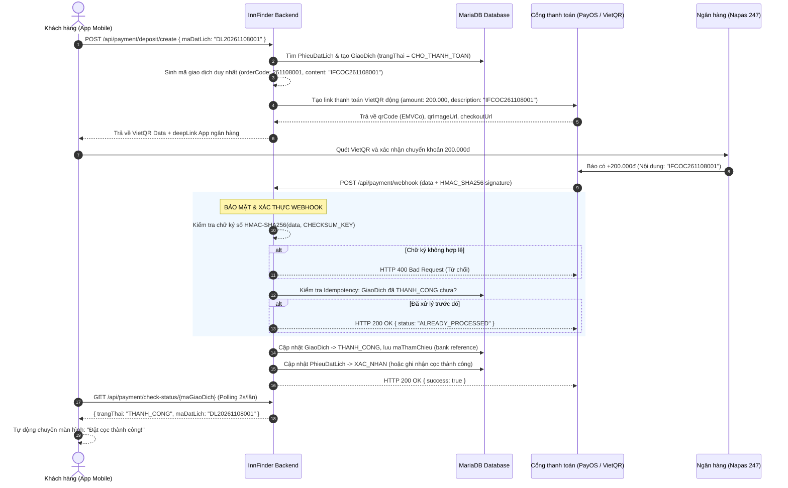

# KẾ HOẠCH TRIỂN KHAI: NỘP CỌC & NẠP TIỀN TỰ ĐỘNG 100% QUA VIETQR VÀ WEBHOOK (PAYOS / VIETQR / SEAPAY)

## Goal Description
Hiện tại trên hệ thống InnFinder, việc nộp cọc giữ chân lịch xem phòng (`/api/appointments/{id}/pay-deposit`) đang hoạt động dưới dạng trừ tiền giả lập (mock balance) trong ví hoặc ghi nhận thủ công. Mục tiêu của tính năng này là xây dựng luồng **Thanh toán & Nộp cọc tự động 100%** thông qua Cổng thanh toán & VietQR động (Dynamic QR Code):
1. **Sinh mã giao dịch & nội dung chuyển khoản duy nhất**: Ví dụ `IFCOC` + số ngẫu nhiên/mã lịch hẹn (ví dụ: `IFCOC123456`).
2. **Khách hàng quét mã VietQR**: Hiển thị QR Code kèm Deep Link mở nhanh ứng dụng ngân hàng (Vietcombank, MB, Techcombank, Momo...), tự động điền đúng Số tài khoản sàn, Số tiền và Nội dung.
3. **Cơ chế Webhook IPN (Instant Payment Notification)**: Cổng thanh toán (PayOS / Casso / SeAPay) phát hiện biến động số dư và gửi HTTP POST ngầm về `/api/payment/webhook`.
4. **Backend xác thực & kích hoạt tức thì (1 - 3 giây)**:
   - Xác thực chữ ký số (HMAC-SHA256 signature / Checksum) chống giả mạo request.
   - Xử lý Idempotency chống trừ tiền / xử lý lặp khi mạng retry.
   - Khớp nội dung giao dịch `IFCOC123456` với `maDatLich` và cập nhật `GiaoDich` -> `THANH_CONG`.
   - Tự động kích hoạt trạng thái phiếu hẹn sang `XAC_NHAN` (hoặc đánh dấu đã nộp cọc), kích hoạt Realtime / Polling thông báo tức thì trên Mobile.

---

## User Review Required

> [!IMPORTANT]
> **LỰA CHỌN CỔNG THANH TOÁN CHÍNH THỨC**:
> 1. **Phương án A (Khuyến nghị số 1 - Khuyên dùng): PayOS (Cổng thanh toán VietQR thế hệ mới)**:
>    - Hỗ trợ tài khoản cá nhân & doanh nghiệp, tạo link VietQR động chuẩn Napas 247.
>    - Miễn phí khởi tạo, không phí duy trì.
>    - Cung cấp cơ chế Webhook có chữ ký bảo mật số HMAC-SHA256 cực kỳ an toàn, có môi trường Sandbox giả lập thanh toán 100% trong 2 giây để test mà không cần chuyển tiền thật.
> 2. **Phương án B: VietQR Open API + Casso / SeAPay**:
>    - Tự sinh ảnh VietQR theo format Napas 247, dùng bot ngân hàng (Casso/SeAPay) đọc biến động số dư tài khoản cá nhân để bắn webhook.
>    - Nhược điểm: Phụ thuộc vào việc duy trì kết nối Internet Banking của bên thứ 3, dễ bị ngân hàng ngắt phiên (disconnect/OTP).
> 3. **Phương án C: Đa cổng thanh toán (Multi-Gateway Adapter)**:
>    - Xây dựng lớp trừu tượng `PaymentGatewayService` với triển khai mặc định là **PayOS**, đồng thời có sẵn **MockPaymentService** (dành cho môi trường Dev/Unit test) và sẵn sàng mở rộng sang VNPay/Momo khi sàn lên quy mô lớn.

> [!WARNING]
> **ĐỒNG BỘ QUY TRÌNH SWIMLANE VỚI TRẠNG THÁI LỊCH HẸN**:
> Theo tài liệu chuẩn `AGENTS.md` Mục 2.3:
> - Khách hàng tạo lịch xem phòng (`CHO_XAC_NHAN`) và nộp cọc giữ chân cho hệ thống.
> - Sau khi Webhook báo cọc thành công: Hệ thống cập nhật `GiaoDich` -> `THANH_CONG`, cờ `daNopCoc = true`, và tự động chuyển `TrangThaiDatLich` sang `XAC_NHAN` (theo đúng yêu cầu của User: kích hoạt lịch hẹn thành công chỉ sau 1-3 giây để Chủ trọ chuẩn bị đón khách).

---

## Open Questions

> [!NOTE]
> 1. **Khách hàng thanh toán qua VietQR**: Bạn muốn hỗ trợ nộp cọc giữ chân theo cả 2 hình thức:
>    - (a) Quét mã VietQR chuyển khoản trực tiếp qua ngân hàng (PayOS Webhook).
>    - (b) Thanh toán bằng số dư Ví InnFinder (nếu ví khách đã có tiền nạp sẵn).
>    *(Kế hoạch này sẽ hỗ trợ cả hai: Nếu ví đủ tiền thì cấn trừ ví tức thì, nếu chọn VietQR thì sinh mã QR PayOS).*
> 2. **Cơ chế phản hồi Realtime trên App Mobile**: Khi Webhook backend kích hoạt thành công sau 1-3 giây, màn hình hiển thị mã QR trên Mobile sẽ tự động đóng và chuyển sang màn hình "Thành công" thông qua cơ chế Polling ngắn (mỗi 2 giây gọi check status) kết hợp fallback. Đây là giải pháp ổn định nhất cho React Native không cần cấu hình cụm WebSocket phức tạp.

---

## Kiến trúc Luồng Xử lý (Sequence Diagram)



---

## Proposed Changes

### 1. Database Migration (Flyway V8)

#### [NEW] `V8__add_payment_gateway_fields_to_giao_dich.sql`
- Thêm trường `ma_tham_chieu` (VARCHAR 100) để lưu mã ngân hàng / transaction id / order_code phía PayOS.
- Thêm trường `phuong_thuc` (VARCHAR 30) (`VIETQR`, `PAYOS`, `WALLET`, `VNPAY`).
- Thêm trường `ma_dat_lich` (VARCHAR 50, FOREIGN KEY liên kết `phieu_dat_lich`).
- Tạo index trên `(ma_tham_chieu)` và `(ma_dat_lich, trang_thai)` để tăng tốc độ xử lý webhook.

---

### 2. Cấu hình Backend & Thư viện

#### [MODIFY] `backend/pom.xml`
Bổ sung thư viện hỗ trợ mã hóa HMAC và kết nối PayOS / HttpClient:
```xml
<!-- PayOS Java SDK hoặc Spring WebClient / OkHttp -->
<dependency>
    <groupId>vn.payos</groupId>
    <artifactId>payos-java</artifactId>
    <version>1.0.8</version>
</dependency>
```

#### [MODIFY] `backend/src/main/resources/application.yml`
Bổ sung cấu hình cổng thanh toán:
```yaml
payos:
  client-id: ${PAYOS_CLIENT_ID:mock_client_id}
  api-key: ${PAYOS_API_KEY:mock_api_key}
  checksum-key: ${PAYOS_CHECKSUM_KEY:mock_checksum_key}
  return-url: ${PAYOS_RETURN_URL:https://innfinder.vn/payment/success}
  cancel-url: ${PAYOS_CANCEL_URL:https://innfinder.vn/payment/cancel}
```

#### [MODIFY] `backend/src/main/java/com/innfinder/backend/config/SecurityConfig.java`
- Cấu hình mở quyền truy cập công khai cho endpoint nhận Webhook từ cổng thanh toán (không yêu cầu JWT Bearer Token vì Cổng thanh toán gọi từ server ngoài, xác thực bằng HMAC Checksum):
```java
.requestMatchers("/api/payment/webhook").permitAll()
.requestMatchers(HttpMethod.GET, "/api/payment/check-status/**").authenticated()
```

---

### 3. Entity & Repository

#### [MODIFY] `GiaoDich.java`
- Thêm các trường:
  - `private String maThamChieu;`
  - `private String phuongThuc;`
  - `@ManyToOne(fetch = FetchType.LAZY) @JoinColumn(name = "ma_dat_lich") private PhieuDatLich phieuDatLich;`

#### [MODIFY] `GiaoDichRepository.java`
- Thêm phương thức tìm kiếm:
  - `Optional<GiaoDich> findByMaThamChieu(String maThamChieu);`
  - `Optional<GiaoDich> findByPhieuDatLich_MaDatLichAndTrangThai(String maDatLich, TrangThaiGD trangThai);`

---

### 4. DTO Layer

#### [NEW] `com.innfinder.backend.dto.payment`
1. `CreateDepositPaymentRequest`: Chứa `maDatLich`, `phuongThuc` (`VIETQR` hoặc `WALLET`).
2. `PaymentCheckoutResponse`:
   - `orderCode`: Long (Số định danh đơn hàng duy nhất)
   - `maGiaoDich`: String (Mã GD nội bộ, vd: `GD20261108001`)
   - `maDatLich`: String
   - `soTien`: Long
   - `noiDungChuyenKhoan`: String (Vd: `IFCOC261108001`)
   - `qrCode`: String (Chuỗi raw VietQR EMVCo)
   - `qrImageUrl`: String (Link ảnh VietQR động quét tức thì)
   - `tenNganHang`: String (Vd: "MB Bank")
   - `soTaiKhoan`: String (Số tài khoản sàn)
   - `tenChuTaiKhoan`: String (Chủ tài khoản sàn)
   - `thoiHanGiay`: Long (Vd: 900 giây = 15 phút)
3. `PayOSWebhookRequest` & `PayOSWebhookData`:
   - Mapping payload JSON chuẩn từ PayOS (gồm `code`, `desc`, `data`, `signature`).
4. `PaymentStatusResponse`:
   - `trangThai`: `CHO_THANH_TOAN` / `THANH_CONG` / `THAT_BAI`
   - `maDatLich`: String
   - `soTien`: Long

---

### 5. Service Layer (Nghiệp vụ cốt lõi)

#### [NEW] `com.innfinder.backend.service.PaymentService.java`
- **Phương thức `taoYeuCauNopCoc(String username, CreateDepositPaymentRequest request)`**:
  1. Kiểm tra phiếu đặt lịch: Khách hàng hợp lệ, trạng thái cho phép nộp cọc (`CHO_XAC_NHAN` hoặc `XAC_NHAN`), số tiền `coc > 0`.
  2. Kiểm tra nếu khách chọn `WALLET`: Trừ tiền ví tức thì và ghi nhận thành công.
  3. Nếu chọn `VIETQR` (PayOS):
     - Sinh `orderCode` ngẫu nhiên/tuần tự kiểu số nguyên: `Long orderCode = System.currentTimeMillis() % 1000000000L;`
     - Sinh nội dung chuyển khoản duy nhất: `String transferContent = "IFCOC" + orderCode;`
     - Tạo bản ghi `GiaoDich` với `trangThai = CHO_THANH_TOAN`, `phuongThuc = "VIETQR"`, `maThamChieu = orderCode.toString()`.
     - Gọi `payOS.createPaymentLink(...)` để tạo liên kết VietQR.
     - Trả về `PaymentCheckoutResponse` chứa đầy đủ QR Image URL và mã chuyển khoản cho Mobile hiển thị.

- **Phương thức `xuLyWebhook(PayOSWebhookRequest webhookPayload)`**:
  1. **Bảo mật Checksum**:
     ```java
     // Xác thực dữ liệu bằng HMAC-SHA256 với CHECKSUM_KEY của sàn
     WebhookData data = payOS.verifyPaymentWebhookData(webhookPayload);
     ```
  2. **Tránh xử lý lặp (Idempotent Guard)**:
     - Tìm `GiaoDich` theo `maThamChieu = String.valueOf(data.getOrderCode())` hoặc tìm theo nội dung chứa `IFCOC...`.
     - Nếu `giaoDich.getTrangThai() == TrangThaiGD.THANH_CONG`, lập tức trả về kết quả thành công mà không chạy lại logic cộng/trừ tiền.
  3. **Cập nhật trạng thái Giao dịch & Lịch hẹn**:
     - Cập nhật `giaoDich.setTrangThai(TrangThaiGD.THANH_CONG)`.
     - Tìm `PhieuDatLich` liên kết:
       - Chuyển `phieu.setTrangThai(TrangThaiDatLich.XAC_NHAN)` (kích hoạt lịch hẹn thành công).
       - Lưu vết thông tin thanh toán vào CSDL.

- **Phương thức `kiemTraTrangThaiGiaoDich(String maGiaoDichHoacOrderCode)`**:
  - Dùng cho Client gọi Polling kiểm tra trạng thái real-time.

---

### 6. Controller Layer

#### [NEW] `com.innfinder.backend.controller.PaymentController.java`
- `POST /api/payment/deposit/create`: Khách hàng tạo phiên thanh toán cọc VietQR.
- `POST /api/payment/webhook`: Endpoint nhận Webhook ngầm từ Cổng thanh toán (Chống giả mạo qua HMAC Checksum).
- `GET /api/payment/check-status/{id}`: Kiểm tra trạng thái thanh toán phục vụ Polling.

---

### 7. Phía Mobile App (React Native / Expo)

#### [MODIFY] `mobile/src/app/booking/deposit-payment.tsx`
- Bổ sung luồng hiển thị **Mã VietQR động**:
  - Khi khách chọn phương thức `VIETQR` và bấm "Tiến hành nộp cọc":
    - Hiển thị Modal/Màn hình thanh toán VietQR:
      * Ảnh mã QR động (render từ URL VietQR với logo Napas và ngân hàng).
      * Nút "Mở App Ngân Hàng" (Deep link `banking://` hoặc VietQR app link).
      * Bảng thông tin: Ngân hàng, Chủ tài khoản, Số tiền, Nội dung chuyển khoản (kèm nút Copy 1-chạm).
      * Đồng hồ đếm ngược thời gian thanh toán (15:00).
      * Loading spinner tinh tế kèm trạng thái: "Đang chờ hệ thống ghi nhận chuyển khoản...".
    - Cơ chế **Auto-detect Polling**: Cứ 2 giây gọi `GET /api/payment/check-status/{maGiaoDich}`. Ngay khi backend nhận được Webhook và đổi thành `THANH_CONG`, màn hình tự động hiển thị hiệu ứng Thành công và chuyển về trang Lịch hẹn.

---

## Verification Plan

### Automated Tests
1. **Unit Test HMAC Verification**:
   - Viết test case giả lập Webhook request với chữ ký đúng -> Kỳ vọng kết quả `HttpStatus.OK`.
   - Viết test case giả lập hacker sửa đổi số tiền hoặc gửi sai chữ ký -> Kỳ vọng ném `AppException` hoặc mã lỗi bảo mật.
2. **Integration Test Idempotency**:
   - Gửi 2 request Webhook giống hệt nhau liên tiếp -> Kỳ vọng giao dịch chỉ được xử lý đúng 1 lần, lần 2 trả về trạng thái đã xử lý mà không bị lỗi duplicate hay ghi đè.

### Manual Verification
1. **Test bằng PayOS Sandbox**:
   - Tạo yêu cầu cọc cho một phòng trọ trên Mobile.
   - Nhận mã VietQR và nội dung `IFCOC...`.
   - Dùng tính năng "Giả lập chuyển khoản" trên Dashboard PayOS Sandbox.
   - Quan sát Backend log: Webhook nhận về sau 1 giây, xác thực signature thành công, cập nhật CSDL.
   - Quan sát App Mobile: Màn hình QR tự động đóng, thông báo "Nộp cọc giữ chân thành công!" xuất hiện.
2. **Test bằng Ngân hàng thật (VietQR Mini-transfer)**:
   - Chuyển khoản số tiền nhỏ (ví dụ 2.000 VNĐ - 10.000 VNĐ) vào tài khoản thực tế cấu hình trên PayOS.
   - Xác nhận tiền về tài khoản sàn và lịch hẹn kích hoạt trong 1 - 3 giây.
